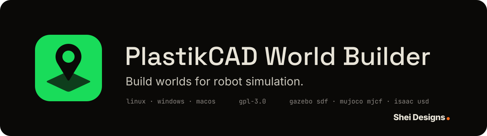

<h1 align="center">
  
</h1>

Build the world a robot is simulated in: place the objects and robots that
[PlastikCAD](https://github.com/Shei-Designs/PlastikCAD) makes, set the
ground, the lights and the spawn points, and write the scene for Gazebo,
MuJoCo or Isaac Sim in each engine's own format.

PlastikCAD makes the things (a staircase, a table, a robot); PlastikWorld
places them and describes the scene. The split is deliberate: PlastikCAD
stays a modeller with a flat floor, and this app is the environment editor
beside it, for people doing rapid prototyping on open source tools (ROS 2,
Gazebo, MuJoCo, Isaac Sim, Blender) who want one pipeline instead of five.

Runs locally on Linux, Windows and macOS; nothing leaves your machine. Free
software under the GPL-3.0.

PlastikWorld is a [Shei Designs](https://sheidesigns.com) project,
designed and built by [Andrew O'Shei](https://andrewoshei.com).

> **Status: bootstrapped, not yet released.** The model, the three engine
> writers, the package readers and the viewer are in place and tested. The
> Gazebo and MuJoCo exports run in their engines (`pnpm smoke:gazebo`,
> `pnpm smoke:mujoco`: the terrain, the props and the robots land where the
> file puts them, in Gazebo, MuJoCo and Isaac Sim alike; `pnpm smoke:isaac`
> checks the stage with USD and then plays it headless). See [Roadmap](#roadmap).

## Worlds, saved as you work

A world is saved as you work: a second after the last change, and when the
window is hidden or closed. There is no Save; the dot by the world's name
shows while a change is still being written, and Ctrl+S writes it at once. A
world is one file, `.plastikworld`, and it carries everything in it: the
objects' GLBs, the robot packages, the terrain heights. So a world can be
copied, shared or synced as one thing, and nothing it refers to can go
missing.

On desktop, worlds are kept in `PlastikCAD Worlds` in your Documents folder
unless you pick another in the worlds browser (Ctrl+O), which lists every
world with its picture, newest first. On Android they live in the app's own
storage. In a plain browser they are kept by the browser itself. **Open world
file…** (Ctrl+Shift+O, also dropping a file, or opening one from the Files app
on Android) brings a copy in as a world of its own, with a fresh id, so a file
someone sent never passes for one of yours. **Save a copy…** (Ctrl+Shift+S)
writes the world wherever you like; on Android into `Download/PlastikWorld`,
to share from there.

On Android the system hands over one file at a time, so a robot package comes
in as the zip PlastikCAD exports (dropping a zip works everywhere), and an
export goes out as a zip of the bundle, into `Download/PlastikWorld` and on
to the share sheet. On a narrow screen the side panels open as drawers from
the toolbar.

## How it works

- **Import** a GLB that PlastikCAD exported (meters, colours embedded) and it
  lands at the origin, drawn in the viewport. Import a robot as the folder
  PlastikCAD exported: a ROS 2 package (URDF), a Gazebo model (`model.sdf`) or
  a MuJoCo model (MJCF). The app reads what the writers need (the package
  name, the body to attach, the USD stage the package carries) and draws the
  robot from its OBJ visual meshes.
- **Place** things by dragging on the ground (Alt drags up and down, moves
  snap to the grid step), or type the pose in the inspector. Every object has
  physics tags: static or free with a mass, its friction, and whether it
  collides with its mesh, its box, or not at all.
- **Terrain** is a flat plane or a heightmap (a grid of heights); lights are
  suns, points and spots; spawn points are named poses.
- **Export** writes a self-contained folder for the engine of your choice,
  meshes and robot packages copied in, with a `run.sh` that launches it. On
  the desktop the export panel can start the engine as well: `gz sim` (or the
  ROS 2 launch file when there are robots), MuJoCo's viewer or Isaac Sim
  through the Python that has them (pointed at a venv in the panel), Blender
  with the scene imported. The engine runs on its own, with its output in
  `launch.log` beside the files. A fourth target writes the whole scene as one
  GLB for Blender.

Everything in the world file is SI: meters, kilograms, radians, Z up. The
file (`.plastikworld`) is small JSON: assets by path, placed objects with poses
and physics, the terrain, lights and spawn points. The writers do the
translation.

| Engine | What is written |
| --- | --- |
| Gazebo (Harmonic+, `gz sim`) | An SDF world with the physics, sensor, IMU and contact systems; the ground as a plane or a `<heightmap>` from a 16-bit PNG written beside it; props as static or free `<model>`s with mesh or box collisions and surface friction; Gazebo-model robots `<include>`d by `model://` URI at their pose; ROS-package robots spawned at their pose from a `ros2 launch` file with `ros_gz_sim create`. |
| MuJoCo | An MJCF with the ground as a plane or an `hfield` (heights inline); props as bodies with mesh geoms, an OBJ per asset (MuJoCo reads no GLB), free ones with a `freejoint` and mass; each robot brought in with `<attach>` from its own model file, so its actuators and sensors come along and its stand-in floor does not. |
| Isaac Sim | A USDA stage (text USD, no library needed) with a `PhysicsScene`, the ground as a collision mesh, `DistantLight` and `SphereLight`s, props as meshes with collision (rigid bodies with mass when free), and each robot referenced from the USD stage its PlastikCAD package carries under `isaac/`. |
| Blender | One GLB of the scene (Y up, as glTF wants, turned back on import): the ground, the surface zones as coloured patches, every prop as a mesh at its pose with its colours. Robots stay in their packages and are noted; lights, sky, fog and wind are Blender's own. |

Terrain is one source with three writers: Gazebo wants an image on disk,
MuJoCo wants the heights inline, Isaac wants a mesh.

### Terrain

The ground is a flat plane or a heightmap: a square grid of 65 to 1025
samples a side (2049 with a warning), the one size every engine takes as it
is, over any area. Pick the terrain in the sidebar to shape it. **Generate**
makes a whole field from a seed: rolling waves, hills of noise, ridges or
craters, with a height, a feature size and a level patch in the middle for a
robot to start on; the same seed makes the same field again. **Sculpt** with
a brush: raise, lower, smooth, flatten to the height where the stroke began,
or set a height. Drag on the ground with the left button or one finger; the
right button, the middle button or a second finger still move the camera;
`[` and `]` change the brush size; Esc puts the brush down. Each stroke is
one undo step. **Import a heightmap image** (a greyscale PNG, 8 or 16-bit;
a colour image is read by its brightness; dropping an image on the window
works too) and say what it covers and how high black and white are; the top
of the image is +Y, as Gazebo reads it, so the image a Gazebo export carries
comes back the same way up. **Import real elevation**: a GeoTIFF you have
(USGS 3DEP, SRTM and Copernicus DEM tiles all are), or a place by latitude
and longitude, for which the app fetches the Copernicus GLO-30 tile (30 m a
sample, the world over) from AWS Open Data and reads only the part it needs.
Drag a box on the picture of the DEM, and the terrain takes what that box
covers in meters, north up, no-data holes filled from around them, the
lowest point brought to zero unless you keep the heights above sea level.
Over a few kilometres the flat-earth error is well under a percent. Terrain
is made here and never imported as a mesh: a bridge spans a valley as an
object, a tunnel is an object in the ground.

### Parts

**Parts** (Ctrl+L) opens a library of the generic pieces a world is built
from: walls and rooms, floor slabs, ramps and stairs, fences, roads, parking
lots, curbs, jersey barriers, traffic cones, lamp posts, trees, rocks,
bridge spans, crates, pallets, tables and shelving. None of them is a stored
mesh: each is made from a few numbers (a wall's length, height, thickness
and doorway; a room's size and door; a rock's seed) that you change after
placing it, in the inspector, and every placement of that part changes with
it. Duplicate the asset for a different one. A room is its floor and four
walls as separate convex pieces, which matters for MuJoCo, which collides
with a mesh as its convex hull: the exports give it a geom per piece, so a
robot drives through the doorway rather than into a solid block. Walls,
cones and the rest come with their own physics (a wall fixed, a cone loose
and knockable). Objects modelled in PlastikCAD come in as GLBs beside them.

### Demo drive

Pick anything placed, a robot or a crate standing in for one, and press
**Drive it** in the inspector: W A S D or the arrows move it, Shift creeps,
Q and E strafe a holonomic drive, a gamepad's sticks work, and on a touch
screen a stick appears in the corner. The camera rides along and a line
marks the way. The drive is kinematic, not a simulation: it chooses between
a differential drive, an Ackermann car and a holonomic base, follows the
terrain and the tops of low things like a room's floor, tilts with the
slope, and stops against the boxes of anything higher than a step, saying
what it ran into. That is enough to find a doorway too narrow or a shelf in
the way before the world goes to a simulator. Esc puts the object back where
it was; **Park** keeps it where it was driven. A robot package says how it
is driven, and the import reads it: the gz DiffDrive, AckermannSteering or
MecanumDrive plugin in a URDF or SDF, or the `drive.json` beside a PlastikCAD
MuJoCo model, with the top speed from the wheels' rate and radius and which
way is forward. Any number can be overridden, and the choice is saved with
the world.

### Sky and weather

In the world settings: a sky (a clear day, overcast, dusk, night), fog from
one distance to another in a colour, and a steady wind by speed and
direction. The sky and the fog are what cameras and lidar see in Gazebo and
Isaac Sim, and MuJoCo draws them; the wind blows in Gazebo, through its wind
effects system on every loose object (an approximation that pushes in
proportion to mass, scaled so a well-planted object holds), and in MuJoCo,
through its fluid drag with the air's density set, and the Isaac export says
plainly that it has none. Rain, snow and water are in no engine and stay parked. The smoke tests
blow a light crate along in an 8 m/s wind in Gazebo and MuJoCo, leave a
heavy one standing, and check that Isaac leaves both where they were.

### Surfaces

The ground has one friction, set on the terrain. For more, add surfaces in
the world settings (asphalt, grass, ice, rubber and the rest, each with a
friction, a bounce and a colour) and draw zones on the ground with the plus
by **Surfaces** in the sidebar: a rectangle, dragged out in the viewport,
painted in the surface's colour. Each engine gets the zone its own way:
Gazebo and Isaac Sim get a static mesh patch of the zone's cells laid a
little over the ground with the surface's friction (Isaac's friction rule set
to take the lesser of the two surfaces that meet); MuJoCo gets a heightfield
of the same cells, with priority so its friction counts. One engine differs:
Gazebo's DART drops any friction set on a mesh or a heightmap (between planes
and boxes it takes the lower of the two), so on a heightmap an ice zone slows
a body only when the body's own friction is as low, and the export says so;
on flat ground the zone goes out as a thin box and works. The same goes for
a prop with a mesh collision: give it a box collision where friction matters. The smoke tests set crates on an ice zone and a rubber zone
on the same hillside: on ice a plain crate slides in MuJoCo and Isaac and a
waxed one slides in all three; on rubber every crate holds.

### Controls

| | |
| --- | --- |
| Right-drag / middle-drag / wheel | Turn / pan / zoom the camera; one finger turns, two pan and pinch |
| Click, Shift+click | Select, add to the selection; click on the ground to clear it |
| Drag, Alt+drag | Move on the ground, move up and down |
| Arrow keys, Ctrl+Up/Down | Nudge by the snap step (Shift: 1 m), up and down |
| Ctrl+I, Ctrl+Shift+I | Import an object (GLB), a robot package |
| Ctrl+D, Delete, Ctrl+Z, Ctrl+Y | Duplicate, delete, undo, redo |
| Ctrl+S, Ctrl+Shift+S, Ctrl+O, Ctrl+N | Save, save as, open, new |
| Ctrl+E | Export |
| F, Escape | Fit the view; stop placing or clear the selection |

## Development

Requirements: [Node.js](https://nodejs.org) 22+, [pnpm](https://pnpm.io),
[Rust](https://rustup.rs), and the
[Tauri system dependencies](https://tauri.app/start/prerequisites/) for your
platform.

```sh
pnpm install
pnpm tauri dev      # run the desktop app with hot reload
pnpm dev            # or just the UI, in a browser at http://localhost:1440
pnpm test           # model, writer, reader and file-format tests
pnpm typecheck
pnpm build
pnpm tauri build    # build installers into src-tauri/target/release/bundle
cargo test --manifest-path src-tauri/Cargo.toml   # the Rust file commands
```

The writers are also run in the engines themselves. `pnpm smoke:fixtures`
writes two sample worlds (a flat yard and rolling hills, with crates and
PlastikCAD's reference rover in each package format) under `fixtures/out/`,
then each smoke test opens them in the real thing and checks that every placed
object is there, that fixed ones stay put, that dropped ones come to rest on
the ground at the height the world file gives, and that the robot stands on it.
Then it drives the robot: a Twist on `cmd_vel` through the package's bridge in
Gazebo, its wheel motors in MuJoCo, velocity targets on its wheel joints in
Isaac Sim. The rover must cover the distance along its heading, stay upright
and on the ground, and climb the hill it starts on:

```sh
pnpm smoke:gazebo   # Gazebo Harmonic + ROS 2 Jazzy in Docker (PlastikCAD's image; built if missing)
pnpm smoke:mujoco   # needs the mujoco package: MUJOCO_PYTHON=~/venv/bin/python, or python3
pnpm smoke:isaac    # pxr checks, then a headless play in Isaac Sim (ISAACSIM_PYTHON, default ~/isaacsim-env/bin/python)
pnpm smoke:blender  # imports each scene GLB into a headless Blender and finds every prop back at its place
```

```sh
pnpm tauri android dev           # the Android app on a connected tablet (or an emulator), with hot reload
pnpm tauri android build --apk   # the Android app; a debug APK with --debug
```

The Android build wants `ANDROID_HOME`, `NDK_HOME` and `JAVA_HOME` in the
environment and the four Rust Android targets installed, as for PlastikCAD.
Release builds are signed with the key named in
`~/.android/plastikworld-keystore.properties` (never in the repository); without
it the APK is left unsigned. CI builds a debug APK on every push.
[docs/release.md](docs/release.md) walks through a release: the key, the
version, the bundle, and the Play listing with its texts and graphics.

The Isaac play starts Omniverse Kit, which asks for NVIDIA's EULA the first
time. Accepting it is your call, so the script does not do it for you: run
`OMNI_KIT_ACCEPT_EULA=YES pnpm smoke:isaac` once you have.

The dev server is pinned to port **1440** (HMR 1441, `vite preview` 1442) so
that it runs beside PlastikCAD's, which is on 1430: both apps can be developed
and tested at the same time.

In a browser the app works without files on disk: assets are read when
imported, the world and the exports download (robot packages cannot be copied
into a downloaded bundle, since a browser cannot read folders). The desktop
app keeps worlds in `~/Documents/PlastikCAD Worlds` unless another folder is
chosen, autosaves a world that has been saved once, and writes exports into
a folder you pick, robot packages copied in.

### The brand

The icon and the banner follow the Shei Designs product rules: the shared
rounded tile in the app's own Terrain green (`#19DC5A`, the widest free gap on
the product colour wheel, between Plot lime and Filament teal), a placement
pin standing on a plot of ground in Carbon, the pin's eye as the one cutout,
and the product name in Space Grotesk. `docs/brand/draw.cjs` draws them
(`pnpm brand`) into `docs/brand/`, `public/icon.svg` and `docs/banner.svg`,
and the Play Store's feature graphic (1024 × 500, the lockup on Carbon) and
512 px icon as PNGs through `rsvg-convert` when it is installed; after a
change, rasterize the tile at 1024 px (`rsvg-convert`) and regenerate
the platform icons with `pnpm tauri icon docs/brand/icon.json`. In the app the
surfaces are tinted a few percent toward the green, the green marks what is
selected or active, and Tape orange stays the house signal for the primary
action and the unsaved dot.

### How it is put together

```
src/
  model/              the world: types, the file format, vector and rotation arithmetic
  io/
    gazebo.ts         the SDF world writer (and the ROS 2 launch file)
    mjcf.ts           the MuJoCo world writer
    usda.ts           the Isaac Sim stage writer
    export.ts         what the writers share: bundles, resolved meshes
    heightmap.ts      sampling, resampling and making terrain
    png.ts, obj.ts    the heightmap image, the OBJ MuJoCo reads
    meshes.ts         GLB and OBJ loading with three.js (webview only)
    xml.ts, scan.ts   the XML reader (from PlastikCAD)
  robot/package.ts    reading a robot package: what it is, its meshes and where they sit
  state/              the editor: the world, selection, undo, files, export; the asset cache; preferences
  viewer/Viewer.ts    the three.js view: camera, grid, picking and dragging (camera and touch from PlastikCAD)
  ui/                 React components
  platform.ts         desktop app or plain browser: dialogs, files, folders, drops
src-tauri/            native window, file dialogs, reading, writing and copying files (Rust)
docs/brand/           the icon and banner, and the script that draws them
```

## Roadmap

Decided with Andrew on 2026-11-01, in order; [docs/plan.md](docs/plan.md)
splits it into phases, each testable on its own and each checked on Android
as well as the desktop. The line for the whole app:
what all three engines can read is a feature; what one engine does alone
exports with a note in the other two, the way robot package clashes do now.

1. **Drive the robots in the exported worlds** from the smoke tests. Done:
   cmd_vel through the package's bridge in Gazebo, the wheel motors in
   MuJoCo, wheel velocity targets in Isaac (the packages' stages carry no
   ROS 2 graph; PlastikCAD's own Isaac export does, and its `smoke:usd`
   drives that over ROS 2), so the exports are proven usable, not just
   loadable.
2. **Terrain tools.** Sculpting in the viewer (raise, lower, smooth, flatten
   and set, done) and seeded fields (rolling, hills, ridges, craters, done);
   a heightmap from an image (8 or 16-bit greyscale PNG with a size and a
   height scale, done); real elevation (a GeoTIFF, or a Copernicus tile
   fetched for a place, done; a map picker later); real elevation from GeoTIFF or DEM tiles (USGS 3DEP, SRTM,
   Copernicus), a box picked and resampled onto the grid. Terrain is made
   here, never imported as a mesh: a bridge spans a valley as an object, a
   tunnel is an object in the ground. Grid sizes snap to Gazebo's 2^n + 1
   (65 to 1025 samples a side, 2049 with a warning, since Isaac gets the
   ground as a triangle mesh); the user picks area and spacing and sees the
   sample count. Past 129 square the heights move to a 16-bit PNG beside the
   world file.
3. **Surfaces.** Done: a table of materials (friction, restitution,
   colour) and rectangular zones on the terrain, each a ground collision of
   its own in every engine. Textures and
   free-form zones later.
4. **A parts library.** Done, all of it generated from parameters in the
   app: walls, rooms, slabs, ramps, stairs, fences, roads, parking lots,
   curbs, barriers, cones, lamp posts, trees, rocks, bridges, crates,
   pallets, tables and shelving. A pack of pieces modelled in PlastikCAD can
   join later as GLB assets.
5. **Demo drive.** Done: kinematic teleoperation with keyboard, gamepad or
   an on-screen stick, three drive models, ground following and box
   collision with a message for what was hit.
6. **Sky, lighting, fog and wind.** Done: sky presets, linear fog and a
   wind vector, written for Gazebo and MuJoCo, with a dome light and a note
   for Isaac.
7. **Release surface.** Done: the export panel starts the engine (or
   Blender) on the desktop, the worlds browser shows each world's picture,
   the scene exports as one GLB for Blender, and `docs/release.md` carries
   the Android release and Play listing. Still to come: Drive sync and the
   touch entry sheet from PlastikCAD.

Parked: rain and snow (no engine has them) and water (Gazebo alone, through
its buoyancy and hydrodynamics plugins), as a later opt-in with notes.

## License

GPL-3.0-or-later. See [LICENSE](LICENSE).

Copyright © 2026 Andrew O'Shei, Shei Designs.
